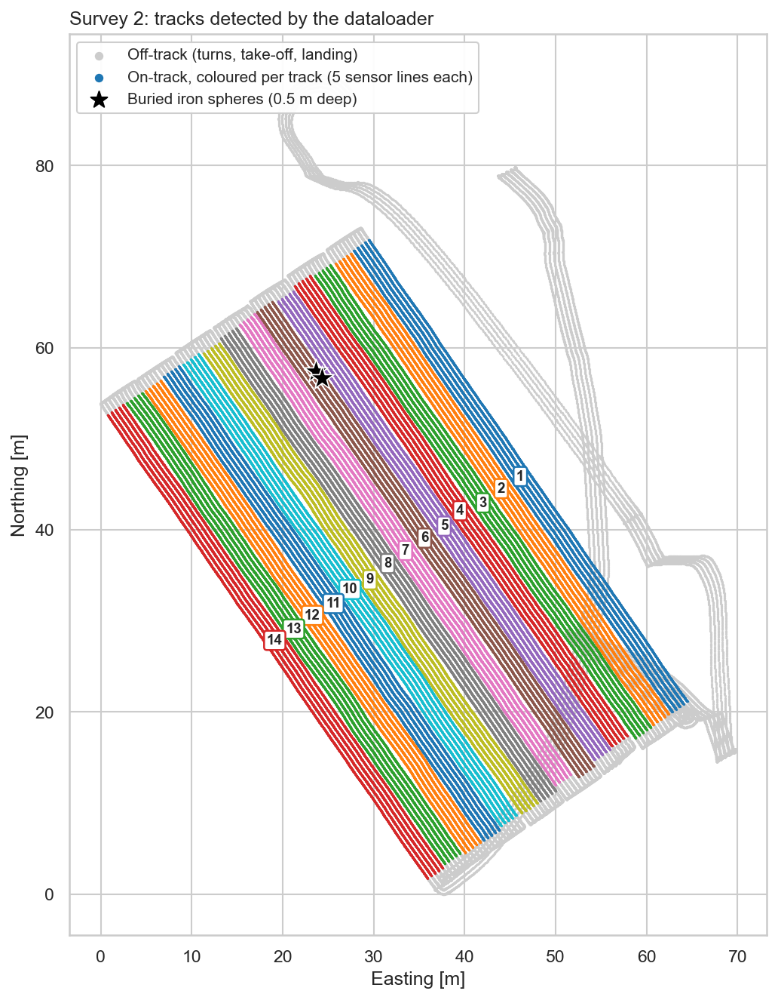
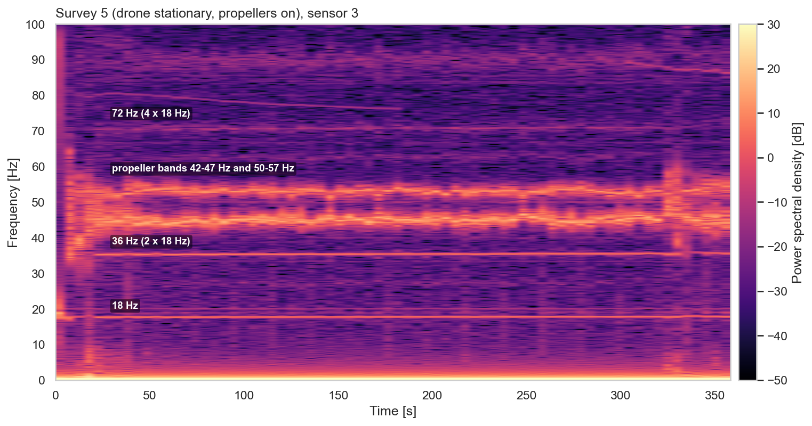
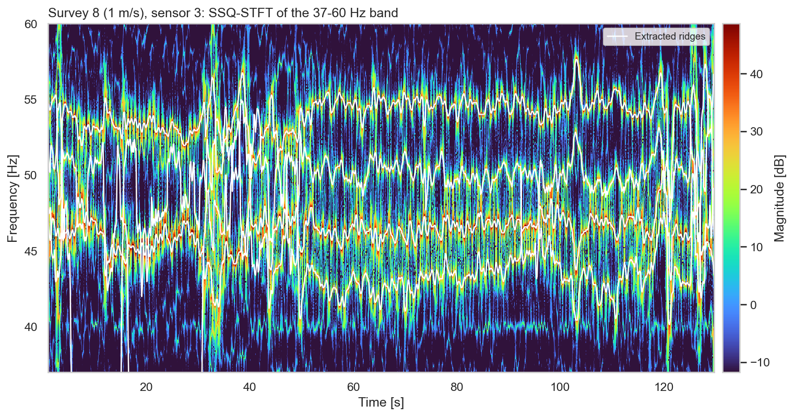
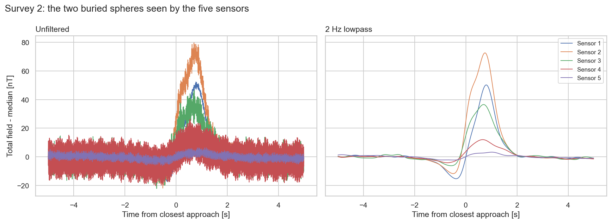
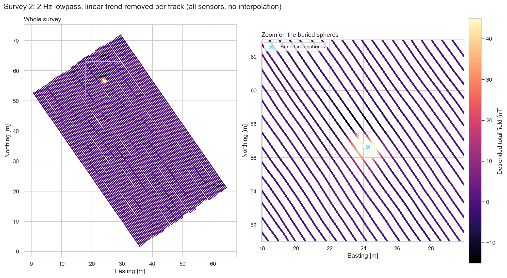

# Thesis: Optimization of high-resolution drone-based geophysical prospection

Drones make magnetometry surveys faster and cheaper than walking them, but the drone makes a lot of noise from
its motors, propellers and electronics which leave traces in the magnetometer data. The reason we wanted to 
identify and eliminate the noise is because it can hide small or weak anomalies. This project characterizes that noise,
attempted to model it, and builds the processing to get clean anomaly maps out of drone-based fluxgate data.

**Results** the noise is not random but structured. It consists of distinct frequency bands linked to the
electronics (a 16.7 Hz harmonic family and 20 Hz), the propellers (four motor ridges between 40 and 60 Hz that
shift with flight velocity) and vibrations (18 Hz and its harmonics). We filtered and tried to model it:
 a 2 Hz lowpass alone raises the SNR of the buried test objects up to about 4 times
(e.g. from 21 to 75 on sensor 2), and adjusting the flight (flying lower and/or slower) makes the detection more reliable.

## Setup

- **Platform:** DJI Matrice 350 RTK with a Sensys MagDrone R4: five triaxial Sensys FGM3D/75 fluxgate
  magnetometers, 0.5 m apart on a 2 m frame, sampled at 200 Hz. GNSS positions at ~5 Hz, drone attitude
  (roll, pitch, heading) at ~30 Hz.
- **Site:** an agricultural field in Bottelare (Belgium), magnetically quiet sandy loam, with two iron spheres
  buried at 0.5 m depth as test anomalies.
- **Campaign:** 12 surveys on 21 January 2025.

| Survey | Index in code | Altitude (AGL) | Heading | Propellers | Velocity | Purpose |
|---|---|---|---|---|---|---|
| 1 | 0 | 1.17 m | constant | on | 1.5 m/s | altitude variation |
| 2 | 1 | 0.87 m | constant | on | 1.5 m/s | baseline |
| 3 | 2 | 0.87 m | variable | on | 1.5 m/s | heading variation |
| 4 | 3 | 0.87 m | constant | on | 1.5 m/s | tie-line |
| 5 | 4 | 0.87 m | - | on | stationary | propeller noise |
| 6 | 5 | 0.87 m | - | off | stationary | electronic noise |
| 7 | 6 | 30 m | constant | on | 1.5 m/s | high altitude |
| 8-12 | 7-11 | 0.87 m | constant | on | 1.0-3.0 m/s | velocity test (+0.5 m/s per survey) |

The thesis numbers the surveys from 1, the code from 0 (`load_survey(1, ...)` is survey 2).
The AGL is that of the altimeter; the magnetometers hang 0.17 m lower.

## Processing pipeline

`src/dataloader.py` turns the raw exports of one flight (GGA, ZDA, PPS, magdata, sensor config and the attitude
log) into one table with a position and track label for every 200 Hz magnetometer sample of every sensor:

1. Put all timestamps on the PPS-corrected clock and match the attitude log to the GNSS fixes in time.
2. Convert WGS84 to UTM 31N and move the GNSS antenna position to the centre sensor and from there to each
   sensor, using the heading, pitch and roll.
3. Label the samples on the survey lines: the course over ground must follow the line axis (in either
   direction) at survey speed. Turns, take-off, landing and transit are off-track.
4. Split the on-track samples into numbered tracks at time gaps and direction changes, and merge segments
   where the drone paused halfway a line.
5. Interpolate positions and attitude from the GNSS rate onto the magnetometer timestamps.



## Results

### The noise is structured

With the drone standing still and the propellers off (survey 6), the sensors only see the electronics: persistent
lines at 16.7, 33.4, 50, 66.7 and 83.5 Hz (a 16.7 Hz harmonic family) and 20 Hz. Above 2 Hz the noise averages
0.16-0.31 nT. Turning the propellers on (survey 5) raises it 4 to 38 times and adds new bands: two propeller
bands at 42-47 and 50-57 Hz, and an 18 Hz line with harmonics at 36, 54 and 72 Hz.

| Mean noise above 2 Hz [nT] | S1 | S2 | S3 | S4 | S5 |
|---|---|---|---|---|---|
| Propellers off (survey 6) | 0.17 | 0.25 | 0.31 | 0.19 | 0.16 |
| Propellers on (survey 5) | 0.75 | 3.48 | 5.44 | 7.17 | 2.46 |



The sensors also have large but stable offsets between each other (up to ~116 nT), which change when the
propellers spin up.

### Propeller ridges follow the flight velocity

The synchrosqueezed STFT separates the propeller bands into four ridges (40-44, 45-47, 49-51 and 51-60 Hz,
roughly 2300-3400 RPM) that move together with the drone's manoeuvres. Tracked over the velocity flights
(surveys 8-12), the first ridge drops by about 0.95 Hz per m/s and the fourth rises by about 0.48 Hz per m/s,
while the middle two stay put.



The envelope of a harmonic can be modelled with an AR(2) process: an ARMA envelope times a sine at the harmonic
frequency reproduces the 16.7 Hz band, a first step towards predicting the drone noise instead of only filtering it.

### Detecting the buried spheres

The anomaly shows up as a two-peak dipole on the sensors that pass over the spheres. A 2 Hz lowpass removes most
of the drone noise while keeping the anomaly, which raises the SNR (peak-to-peak / background std) substantially.



| SNR | S1 | S2 | S3 | S4 | S5 |
|---|---|---|---|---|---|
| Survey 2 (0.87 m), unfiltered | 43.5 | 21.0 | 10.2 | 4.9 | 6.4 |
| Survey 2 (0.87 m), 2 Hz lowpass | 67.7 | 75.3 | 33.9 | 19.1 | 7.3 |
| Survey 1 (1.17 m), 2 Hz lowpass | 39.6 | 61.4 | 30.3 | 16.6 | 8.6 |
| Survey 3 (variable heading), 2 Hz lowpass | 4.5 | 14.8 | 27.8 | 69.7 | 76.9 |

Flying 30 cm lower increases the SNR on four of the five sensors, and the flight heading changes which sensors
see the anomaly best. A sym7 wavelet, which has the shape of a dipole, works as a matched filter to flag anomalies automatically.

### Levelling

Every track has its own linear drift (±0.008-0.012 nT per sample). Removing it per track, and levelling
survey 2 against the crossing tie-line flight (survey 4), gives a consistent map where the spheres stand out.
The thesis grids it with natural neighbour bathymetry; the figure below shows the samples as they are.



## Repository

```
src/
  dataloader.py               load and align a survey, sensor positions, track labelling
  signal_processing_tools.py  filters, FIR band envelopes, SSQ-STFT, SNR
  constant_frequencies.py     sensor offsets, harmonic bands, ARMA noise model
  propellers.py               propeller ridges vs. velocity
  anomaly.py                  anomaly windows, SNR, wavelet matching
  tieline.py                  per-track detrending, tie-line levelling, gridding
  paths.py                    data and output locations
notebooks/
  overview.ipynb              the figures of this README
  constant_frequencies.ipynb  noise of the electronics and harmonics
  propellers.ipynb            propeller ridges
  anomaly.ipynb               the buried spheres
  tieline.ipynb               levelling and gridding
figures/                      README figures
```

All data loading lives in `src/`;

```python
import sys
sys.path.insert(0, "src")
from dataloader import load_survey

survey = load_survey(1, survey_speed=1.5)   # survey 2
# one row per sensor sample: GPS time, Sensor ID, position [m], attitude, velocity,
# Mag-X/Y/Z and total field [nT], Track_status and Track_number
```

### Requirements

Python 3.10 with numpy, scipy, pandas, matplotlib, seaborn, pyproj, statsmodels, ssqueezepy, PyWavelets,
shapely and jupyter.

The interpolation of the datapoints depends on the unreleased PyMEL code from prof. Philippe De Smedt, as
such some figures can not be reproduced with your own data.
